# ARQUITECTURA TÉCNICA Y EMPRESARIAL DE OPENRECON
> **Plataforma Integral de Ciberinteligencia, Superficie de Ataque (EASM), Protección de Marca (DRP) e Inteligencia de Amenazas (CTI)**  
> **Versión:** 2.0 Enterprise  
> **Fecha de Publicación:** 11 de Noviembre de 2026  
> **Licencia:** Open Source (Apache 2.0 / AGPLv3)

---

## 1. INTRODUCCIÓN Y VISIÓN ARQUITECTURAL

OpenRecon está concebido como una plataforma modular, desacoplada y de alta resiliencia diseñada para operaciones defensivas continuas de equipos SOC, Blue Teams y analistas de ciberinteligencia. A diferencia de las soluciones SaaS cerradas (donde los activos corporativos y vulnerabilidades se transfieren a nubes propietarias de terceros), OpenRecon garantiza la **estricta soberanía de los datos de seguridad** permitiendo despliegues híbridos, on-premise o en nubes privadas virtuales (VPC).

Su arquitectura compite directamente con soluciones de nivel empresarial:
- **Fortinet FortiRecon:** Tríada EASM + DRP + CTI.
- **Recorded Future:** Inteligencia de amenazas, feeds STIX 2.1 y seguimiento de actores.
- **Palo Alto Cortex Xpanse:** Mapeo global de activos y topología perimetral.
- **CrowdStrike Falcon Exposure Management:** Priorización basada en KEV y EPSS.
- **SOCRadar:** Dark web intelligence, monitoreo de fugas y ransomware.
- **OpenCTI Platform:** Gestión estructurada de inteligencia de amenazas bajo STIX/TAXII.

---

## 2. DIAGRAMA GENERAL DE ARQUITECTURA

```mermaid
flowchart TD
    subgraph PRESENTATION_LAYER ["Capa de Presentación & SOC Dashboard (15 Módulos)"]
        UI_Dash["1. Dashboard Ejecutivo & Postura"]
        UI_ASM["2. Attack Surface Management (ASM)"]
        UI_Discovery["3. Asset Discovery & Perímetro"]
        UI_Vulns["4. Vulnerability Management (5 Estados)"]
        UI_DRP["5. Digital Risk Protection (Phishing/MX)"]
        UI_CTI["6. Threat Intelligence (Multi-Feed)"]
        UI_DarkWeb["7. Dark Web & Ransomware Leaks"]
        UI_MITRE["8. Matriz MITRE ATT&CK Navigator"]
        UI_IOCs["9. Gestión de IoCs (STIX 2.1)"]
        UI_Ransom["10. Ransomware Intelligence"]
        UI_Risk["11. Scoring Explicable de Riesgo"]
        UI_Invest["12. Investigation Center (Strix/OSINT)"]
        UI_Reports["13. Centro de Reportes & STIX Export"]
        UI_Integ["14. Centro de Conectores (16)"]
        UI_Admin["15. Administración, RoE & Kill-Switch"]
    end

    subgraph GATEWAY_LAYER ["Capa de API Gateway & Gobernanza de Seguridad"]
        APIGW["PHP 8.2 API Gateway (api.php - 66 Acciones)"]
        FastAPI_GW["FastAPI Core Microservice (:8000 - 32 Rutas)"]
        AuthRBAC["Control de Acceso RBAC & Sesiones Seguras"]
        ScopeGuard["Escudo Anti-SSRF & Validador de Alcance RoE"]
        KillSwitch["Interruptor de Parada de Emergencia (Kill-Switch)"]
    end

    subgraph ENGINES_LAYER ["Capa de Motores Especializados de Análisis"]
        Engine_EASM["Motor EASM: DNS, HTTPX, Puertos & Certificados"]
        Engine_Vuln["Motor de Validación Forense (vuln_validator_engine.php)"]
        Engine_Graph["Motor de Correlación Multidimensional (graph_engine.py)"]
        Engine_Risk["Motor de Ponderación Multicriterio (risk_engine.py)"]
        Engine_OpenCTI["Conector Desacoplado OpenCTI (opencti_client.py)"]
        Engine_DarkWeb["Colector Defensivo Dark Web (darkweb_collector.py)"]
        Engine_MISP["Conector de Atributos MISP (misp_client.py)"]
        Engine_Adapters["Adaptadores de Feeds CTI (feed_adapters.py)"]
    end

    subgraph PERSISTENCE_LAYER ["Capa de Datos, Índices & Caché"]
        SQLite_Store[("openrecon.sqlite (25 Tablas + 11 Índices Optimizados)")]
        PG_Store[("PostgreSQL 16 Enterprise DB")]
        Redis_Store[("Redis 7 Cache & Task Queue")]
    end

    subgraph EXTERNAL_INTEL ["Fuentes Vivas de Ciberinteligencia"]
        Feed_KEV["CISA KEV Catalog (1,779 CVEs Activos)"]
        Feed_EPSS["FIRST.org EPSS API (Explotabilidad)"]
        Feed_IPsum["IPsum Multi-Blacklist (Score >= 4)"]
        Feed_Ransom["Ransomwatch / Ransomware.live DLS"]
        Feed_Tor["Red Tor (Transporte Seguro SOCKS5 :9050)"]
        OpenCTI_Inst["Instancia Externa OpenCTI Platform (:8080)"]
        MISP_Inst["Instancia Externa MISP API"]
        Feed_Keys["AbuseIPDB / Shodan / VirusTotal / URLhaus"]
    end

    PRESENTATION_LAYER --> GATEWAY_LAYER
    GATEWAY_LAYER --> ScopeGuard
    ScopeGuard --> KillSwitch
    KillSwitch --> ENGINES_LAYER
    ENGINES_LAYER --> PERSISTENCE_LAYER
    ENGINES_LAYER <--> EXTERNAL_INTEL
```



---

## 3. DESCRIPCIÓN DE CAPAS Y COMPONENTES

### 3.1 Capa de Presentación: Consola Unificada SOC (15 Módulos)
La interfaz web es una Single-Page Application (SPA) optimizada con **Tailwind CSS**, **Chart.js** y **Vis-Network**. Diseñada bajo estándares de Centros de Operaciones de Seguridad (SOC Tier 1 a Tier 3):
1. **Dashboard Ejecutivo:** Métrica global de Exposure Score (0-100), conteo de activos vivos, puertos críticos expuestos y alertas tempranas.
2. **Attack Surface Management (ASM):** Topología interactiva de red en forma de grafo de conocimiento, mostrando relaciones de adyacencia y dependencias.
3. **Asset Discovery:** Inventario perimetral continuo con resolución DNS A/AAAA, inspección de registros CNAME y detección de infraestructura Cloud (AWS, Azure, GCP, Cloudflare).
4. **Vulnerability Management:** Gestión formal del ciclo de vida de vulnerabilidades bajo **5 estados de validación estricta**:
   - `VALIDADA`: Confirmada técnicamente mediante sonda perimetral o presencia en CISA KEV con puerto expuesto.
   - `PROBABLE`: Versión de software perimetral detectada dentro del rango vulnerable de NVD.
   - `POTENCIAL`: Tecnología expuesta sin banner de versión concluyente.
   - `INFO_INSUFICIENTE`: Servicio filtrado o sin respuesta HTTP.
   - `FALSO_POSITIVO`: Descartada técnicamente por el analista (riesgo nulo).
5. **Digital Risk Protection (DRP):** Generación algorítmica de typosquatting y homóglifos contra marcas corporativas, verificación en vivo de servidores MX para detección temprana de phishing y emisión de fichas de Takedown.
6. **Threat Intelligence (CTI):** Panel centralizado de inteligencia de amenazas multifuente con indicadores clasificados por nivel de severidad.
7. **Dark Web Intelligence:** Monitoreo defensivo de sitios de extorsión (.onion), detección de menciones de dominios corporativos y registro de evidencias forenses inmutables.
8. **MITRE ATT&CK Enterprise:** Matriz de navegación interactiva que correlaciona tácticas (Initial Access, Reconnaissance, Impact) con vulnerabilidades y actores perimetrales.
9. **IOC Management:** Catálogo estructurado de Indicadores de Compromiso bajo estándar STIX 2.1 con capacidad de búsqueda, filtrado y exportación.
10. **Ransomware Intelligence:** Monitoreo y perfilado de sindicatos criminales de ransomware (LockBit 3.0, Rhysida, Scattered Spider, etc.), víctimas anunciadas y plazos de extorsión.
11. **Risk Scoring Explicable:** Calculadora matemática de impacto multicriterio que desglosa de manera transparente cada punto de penalización asignado a los activos.
12. **Investigation Center:** Suite integrada de pentesting no destructivo (Sackmesser, Strix, AutoPentestX, PHP2Shell Scanner y correlación OSINT LoginRecon).
13. **Reports:** Generador de reportes ejecutivos en HTML/PDF, avisos de abuso (RFC 2142) y bundles STIX 2.1 JSON.
14. **Integrations:** Centro de control de conectores categorizados en FREE, API_KEY y COMMERCIAL con almacenamiento seguro de tokens.
15. **Administration:** Gobernanza de alcance (RoE), gestión de usuarios, auditoría inmutable de acciones (`audit_logs`) y botón de Parada de Emergencia (Kill-Switch).

---

### 3.2 Capa de API Gateway y Microservicios
OpenRecon opera con una arquitectura híbrida de doble motor:
- **API Gateway PHP 8.2 (`api.php`):** Gestiona 66 acciones REST, renderizado directo de vistas, autenticación de sesiones, control de sesiones concurrentes y consultas de baja latencia contra SQLite/PostgreSQL.
- **FastAPI Core Microservice (`backend/app/main.py`):** Expone 32 rutas OpenAPI documentadas en Swagger UI (`/docs`), gestionando orquestación de tareas en segundo plano, procesamiento asíncrono pesado con `httpx` y `asyncio`, y conexiones STIX 2.1 hacia OpenCTI y MISP.

---

### 3.3 Motor de Validación Forense Perimetral (`vuln_validator_engine.php`)
Diseñado para eliminar el ruido y los falsos positivos que degradan la efectividad de las soluciones tradicionales de escaneo perimetral:
1. **Inspección de Bloqueos Nativos Cloud:** Detecta códigos HTTP 403 generados por balanceadores de Azure App Service, Cloudflare o AWS WAF, catalogándolos como `RIESGO_ACEPTADO` en lugar de fallas críticas de cifrado.
2. **Validación de Redirección Forzada:** Comprueba si las peticiones HTTP (puerto 80) son redirigidas obligatoriamente mediante código 301/308 hacia HTTPS antes de declarar falta de cifrado.
3. **Comprobación de Explotabilidad CORS:** Evalúa la combinación de `Access-Control-Allow-Origin: *` con `credentials: true`. Por especificación W3C, esta combinación es rechazada por los navegadores modernos, descartándola como falso positivo de explotación.
4. **Verificación Estricta DMARC/SPF/CAA:** Consulta los registros DNS autoritativos para validar herencia de políticas corporativas estrictas (`p=reject`), evitando falsos positivos de suplantación.

---

### 3.4 Motor de Integración Desacoplado OpenCTI (`opencti_client.py`)
El conector con OpenCTI Platform opera bajo el principio de **alta resiliencia y degradación grácil**:
- **Protocolo de Comunicación:** Consultas GraphQL sobre HTTP/HTTPS contra el endpoint `/graphql` de OpenCTI.
- **Tolerancia a Desconexión:** Si la instancia de OpenCTI se detiene, reinicia o está fuera de línea, OpenRecon **no detiene sus operaciones**: degrada automáticamente a modo local utilizando los catálogos en caché (`opencti_indicators` y `cisa_kev_catalog`).
- **Exportación STIX 2.1:** Transforma automáticamente los activos, puertos y vulnerabilidades descubiertas en un `STIX 2.1 Bundle` estándar con objetos `Identity`, `Indicator` y `Vulnerability`, listo para ser consumido por TAXII o importado en OpenCTI.

---

### 3.5 Colector Defensivo Dark Web & Ransomware (`darkweb_collector.py`)
Módulo especializado en inteligencia de fuentes oscuras con salvaguardas éticas y técnicas rigurosas:
- **Transporte Tor Seguro:** Enrutamiento exclusivo de peticiones HTTP a través de proxy local SOCKS5 (`127.0.0.1:9050`) hacia fuentes autorizadas y espejos públicos.
- **Garantía No-Exec / No-Store:** Prohibición absoluta de ejecutar archivos o código remoto descargado. Prohibición de descargar volcados masivos o bases de datos robadas.
- **k-Anonimato en Credenciales:** Las credenciales detectadas se procesan en memoria: se anonimiza el usuario (`di***@empresa.com`) y se almacena únicamente el hash criptográfico SHA-256. Jamás se persisten contraseñas en texto claro.
- **Trazabilidad Forense:** Cada coincidencia de ransomware incluye un hash SHA-256 generado a partir de la tupla `(grupo, víctima, fecha, semilla)` para garantizar la inmutabilidad de la evidencia.

---

### 3.6 Motor de Correlación Multidimensional de Grafos (`graph_engine.py`)
Modela la superficie de ataque y la inteligencia de amenazas como un grafo dirigido de conocimiento:
```
Organización ──[OWNS]──> Dominio ──[CONTAINS]──> Subdominio ──[RESOLVES_TO]──> IP
                                                      │                          │
                                                      │                   [EXPOSES_PORT]
                                                      │                          │
                                                      v                          v
                                                Vulnerabilidad ◄────────── Puerto/Servicio
                                                      │
                                               [IDENTIFIED_AS]
                                                      │
                                                      v
                                                     CVE ◄──[ACTIVELY_EXPLOITS]── Threat Actor
```
- **Niveles de Confianza (0-100%):** Cada relación (arista) lleva un porcentaje de confianza basado en la técnica de recolección (ej. resolución directa DNS = 100%, coincidencia pasiva de banner = 85%).
- **Trazado de Rutas de Ataque (Attack Path Tracing):** Algoritmo de búsqueda en anchura (BFS) que identifica caminos directos desde un actor de amenazas conocido hasta los subdominios corporativos de la organización.

---

### 3.7 Motor Inteligente de Riesgo Explicable (`risk_engine.py`)
Sustituye las métricas opacas de riesgo por una fórmula explicable multicriterio con pesos configurables:

$$\text{RawScore} = (S_{\text{CVSS}} \times 0.25) + (S_{\text{EPSS}} \times 0.20) + (S_{\text{KEV}} \times 0.25) + (S_{\text{Exposición}} \times 0.15) + (S_{\text{Ransomware}} \times 0.15)$$

- **Ajuste por Estado de Validación:**
  - `VALIDADA`: Multiplicador $\times 1.15$ (Penalización por confirmación técnica).
  - `PROBABLE`: Multiplicador $\times 1.00$.
  - `POTENCIAL` / `INFO_INSUFICIENTE`: Multiplicador $\times 0.75$ (Reducción por incertidumbre).
  - `RIESGO_ACEPTADO`: Penalización residual fija (15 pts).
  - `FALSO_POSITIVO` / `MITIGADA`: **0.0 puntos (Riesgo nulo garantizado)**.

---

## 4. TOPOLOGÍA DE PERSISTENCIA Y MODELO DE DATOS

La plataforma implementa un esquema de persistencia relacional altamente indexado:
- **`openrecon.sqlite` (25 Tablas Principales):**
  - `seeds`, `assets`, `open_ports`, `vulnerabilities`, `vuln_validation_history`
  - `cisa_kev_catalog` (1,779 registros precargados con búsqueda por índice de texto)
  - `connectors_config` (16 proveedores CTI con cifrado y enmascaramiento de tokens)
  - `threat_iocs`, `threat_actors`, `threat_campaigns`, `mitre_techniques`
  - `drp_threats`, `credential_leaks`, `ransomware_leaks`, `darkweb_mentions`
  - `authorized_scope`, `users`, `audit_logs`, `kill_switch_state`
  - `scheduled_monitors`, `infrastructure_diffs`, `cloud_exposures`
- **11 Índices de Alto Rendimiento:**
  - Búsquedas de subdominios, CVEs y estados de validación en tiempo constante $O(1)$ o logarítmico $O(\log n)$, logrando respuestas inferiores a 5ms en bases de datos con decenas de miles de registros.

---

## 5. TOPOLOGÍA DE DESPLIEGUE EN PRODUCCIÓN (DOCKER)

Para despliegues empresariales escalables, OpenRecon utiliza `docker-compose.yml`:
1. **Contenedor `openrecon-api`:** Microservicio FastAPI en Python 3.11 con binarios estáticos de ProjectDiscovery (`subfinder`, `httpx`, `naabu`, `nuclei`) y librerías de IA (`opencv`, `numpy`, `pillow`).
2. **Contenedor `openrecon-web`:** Servidor Nginx + PHP 8.2-FPM sirviendo el SOC Dashboard y el API Gateway.
3. **Contenedor `openrecon-postgres`:** Motor relacional PostgreSQL 16 para persistencia empresarial multi-tenant.
4. **Contenedor `openrecon-redis`:** Broker de colas en memoria Redis 7 para distribución de tareas pesadas de escaneo.
5. **Contenedor `openrecon-tor` (Opcional):** Proxy SOCKS5 de Tor en localhost:9050 para el colector defensivo de Dark Web.

---

## 6. CONCLUSIÓN DE ARQUITECTURA

La arquitectura de OpenRecon 2.0 logra el equilibrio óptimo entre **modularidad desacoplada**, **soberanía total de datos**, **precisión forense en validación de vulnerabilidades** y **compatibilidad con estándares internacionales de ciberinteligencia (STIX 2.1, MITRE ATT&CK, CISA KEV y FIRST EPSS)**, constituyendo una alternativa sólida y libre frente a las soluciones comerciales privativas del mercado.
