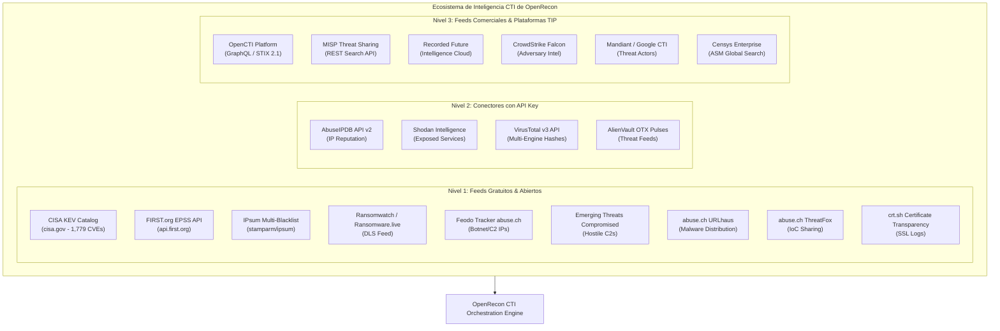

# INTEGRACIONES DE CIBERINTELIGENCIA (CTI) — OPENRECON 2.0
> **Manual de Integraciones, Conectores STIX 2.1, Plataformas OpenCTI/MISP y Telemetría Dark Web**  
> **Fecha de Publicación:** 11 de Noviembre de 2026

---

## 1. VISIÓN GENERAL DE INTEGRACIONES CTI

OpenRecon implementa un modelo de ingesta de inteligencia desacoplado y categorizado en tres niveles estrictos:
1. **Feeds Gratuitos y Abiertos (Tier FREE):** Ingesta automática sin requerimiento de credenciales ni costos de licenciamiento.
2. **Feeds Comunitarios con API Key (Tier API_KEY):** Requieren registro y token de autenticación gratuito o freemium.
3. **Plataformas Empresariales y Feeds Comerciales (Tier COMMERCIAL):** Conectores preparados para consumir telemetría especializada mediante suscripción.

---

## 2. INTEGRACIÓN OPENCTI (STIX 2.1)

### 2.1 Principio de Desacoplamiento y Resiliencia
OpenCTI ([https://github.com/OpenCTI-Platform/opencti](https://github.com/OpenCTI-Platform/opencti)) es la plataforma abierta de referencia para gestión de inteligencia de amenazas basada en STIX 2.1.

OpenRecon implementa una integración desacoplada a través del cliente `OpenCTIClient` (`backend/app/services/cti/opencti_client.py`):
- **Comunicación:** Peticiones HTTP POST contra el endpoint `/graphql` de OpenCTI.
- **Autenticación:** Cabecera `Authorization: Bearer <API_TOKEN>`.
- **Tolerancia a Desconexión (Offline Fallback):** El método `check_health()` evalúa la disponibilidad del servicio. Si OpenCTI no responde o devuelve un código de error, OpenRecon **no interrumpe ninguna operación de escaneo o análisis**: conmuta de forma transparente al catálogo local (`opencti_indicators` y `cisa_kev_catalog`) e informa al analista del estado `DEGRADED_LOCAL`.

### 2.2 Capacidades del Conector OpenCTI
1. **Importación de Indicadores STIX 2.1:** Consulta de patrones estándar (`[ipv4-addr:value = '...']`, `[domain-name:value = '...']`, `[file:hashes.'SHA-256' = '...']`).
2. **Correlación de IoCs con Activos:** Comprobación automática de si alguna IP o subdominio del perímetro corporativo coincide con indicadores activos en OpenCTI.
3. **Seguimiento de Actores de Amenazas:** Ingesta de Intrusion Sets, alias, nivel de sofisticación y motivaciones primarias.
4. **Mapeo MITRE ATT&CK:** Asociación de técnicas ATT&CK (ej. T1190) con los actores que las utilizan activamente.
5. **Exportador Bidireccional STIX 2.1:** Generación de bundles STIX 2.1 estandarizados (`STIX 2.1 Bundle`) conteniendo:
   - Objeto `Identity` (OpenRecon Platform).
   - Objetos `Indicator` para cada activo IP o subdominio descubierto.
   - Objetos `Vulnerability` para cada hallazgo con su correspondiente `cve_id` y puntuación CVSS/EPSS.

---

## 3. INTEGRACIÓN MISP (MALWARE INFORMATION SHARING PLATFORM)

OpenRecon incorpora un conector nativo para instancias MISP a través de `MISPClient` (`backend/app/services/cti/misp_client.py`):
- **Endpoint:** `/attributes/restSearch`.
- **Filtros Aplicados:** Tipo de atributos (`ip-dst`, `ip-src`, `domain`, `hostname`, `url`, `sha256`, `md5`).
- **Respeto de Listas de Advertencia (Warninglists):** Se habilita obligatoriamente `"enforceWarninglist": true` para excluir direcciones IP legítimas de servicios globales (Cloudflare, Google DNS, Akamai, Microsoft Azure) y evitar falsas alertas reputacionales.

---

## 4. COLECTOR DEFENSIVO DE DARK WEB INTELLIGENCE

### 4.1 Arquitectura del Colector
El colector `DarkWebCollector` (`backend/app/services/cti/darkweb_collector.py`) monitorea fuentes públicas de filtraciones y sitios de divulgación de ransomware (Dedicated Leak Sites - DLS).

### 4.2 Protocolo Estricto de Seguridad y Ética
1. **Transporte Tor Seguro:** Utilización exclusiva de túneles proxy SOCKS5 locales (`socks5://127.0.0.1:9050`) hacia fuentes autorizadas.
2. **No Ejecución (No-Exec):** Queda terminantemente prohibida la ejecución o invocación de binarios, scripts o cargas útiles remotas.
3. **No Descarga Indiscriminada:** Se recopilan únicamente metadatos de las publicaciones (nombre de víctima, grupo, fecha, tamaño de datos anunciado y URL de reclamo). Jamás se descargan volcados de bases de datos o archivos filtrados.
4. **No Interacción:** Prohibición absoluta de participar en foros clandestinos, entablar conversaciones con extorsionadores o realizar compras de credenciales.
5. **k-Anonimato en Credenciales Expuestas:** Cuando se detecta un correo corporativo comprometido:
   - Se enmascara la identidad del usuario (`di***@empresa.com`).
   - Se computa el hash criptográfico SHA-256 de la dirección.
   - **Jamás se almacena la contraseña en texto plano**.
6. **Trazabilidad Forense:** Toda evidencia de coincidencia genera un hash inmutable SHA-256:

$$\text{EvidenceHash} = \text{SHA-256}(\text{Grupo} \parallel \text{Víctima} \parallel \text{Fecha} \parallel \text{Semilla})$$

---

## 5. CATÁLOGO DE CONECTORES Y PARÁMETROS DE CONFIGURACIÓN

| Conector | Categoría | Tipo de Autenticación | Endpoint Predeterminado | Tipo de Datos Aportados |
| :--- | :---: | :---: | :--- | :--- |
| **cisa_kev** | FREE | Ninguna | `cisa.gov/sites/default/files/...` | CVEs explotados activamente en ataques reales |
| **first_epss** | FREE | Ninguna | `api.first.org/data/v1/epss` | Probabilidad de explotación real en los próximos 30 días |
| **stamparm_ipsum** | FREE | Ninguna | `raw.githubusercontent.com/.../ipsum.txt` | Agregador de más de 30 listas negras de C2 e IPs maliciosas |
| **ransomwatch** | FREE | Ninguna | `raw.githubusercontent.com/.../posts.json` | Telemetría de víctimas en blogs de ransomware |
| **crtsh** | FREE | Ninguna | `crt.sh/?q=%.domain&output=json` | Logs de transparencia de certificados SSL/TLS |
| **hackertarget** | FREE | Ninguna | `api.hackertarget.com/hostsearch/` | Descubrimiento pasivo de DNS y subdominios |
| **virustotal** | API_KEY | Cabecera `x-apikey` | `www.virustotal.com/api/v3/` | Reputación multicriterio de dominios, IPs y hashes |
| **shodan** | API_KEY | Query Param `?key=` | `api.shodan.io/` | Puertos, servicios y tecnologías expuestas en Internet |
| **abuseipdb** | API_KEY | Cabecera `Key` | `api.abuseipdb.com/api/v2/check` | Score de confianza de abuso perimetral (0-100%) |
| **alienvault_otx** | API_KEY | Cabecera `X-OTX-API-KEY` | `otx.alienvault.com/api/v1/` | Pulses de inteligencia colaborativa de amenazas |
| **urlhaus** | API_KEY / FREE | Cabecera `Auth-Key` | `urlhaus-api.abuse.ch/v1/` | URLs y dominios de distribución de malware |
| **threatfox** | API_KEY / FREE | Cabecera `Auth-Key` | `threatfox-api.abuse.ch/api/v1/` | Indicadores de compromiso de malware y botnets |
| **opencti** | COMMERCIAL / TIP | Cabecera `Bearer` | `http://localhost:8080/graphql` | Inteligencia STIX 2.1, actores, campañas y reportes |
| **misp** | COMMERCIAL / TIP | Cabecera `Authorization` | `https://misp.local/attributes/restSearch` | Eventos y atributos de incidentes compartidos |
| **recorded_future** | COMMERCIAL | Cabecera `X-RFToken` | `api.recordedfuture.com/v2/` | Inteligencia avanzada de amenazas y Dark Web |
| **crowdstrike** | COMMERCIAL | OAuth2 Bearer | `api.crowdstrike.com/oauth2/token` | Inteligencia de adversarios Falcon Exposure Mgmt |

---

## 6. GESTIÓN SEGURA DE SECRETOS Y TOKENS

- **Enmascaramiento en Interfaz:** Las claves de API configuradas por el usuario se muestran enmascaradas (`supe...999`) y jamás se devuelven en texto claro a través de los endpoints de lectura del dashboard.
- **Almacenamiento Protegido:** Los tokens se almacenan en SQLite/PostgreSQL utilizando el campo `api_key_enc`, permitiendo la rotación y revocación segura desde la consola de administración.
