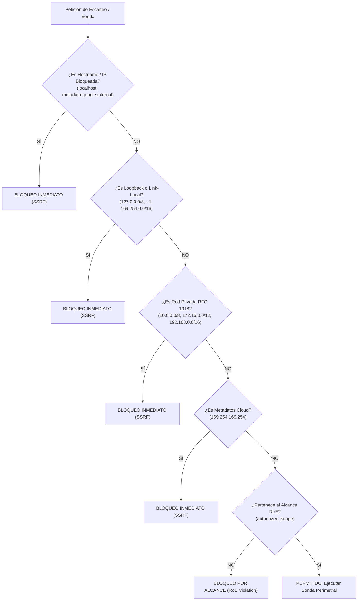

# MODELO DE SEGURIDAD Y GOBERNANZA ROE — OPENRECON 2.0
> **Políticas de Control de Acceso, Blindaje Anti-SSRF, Reglas de Compromiso (RoE) y Parada de Emergencia**  
> **Fecha de Publicación:** 11 de Noviembre de 2026

---

## 1. PRINCIPIOS RECTORES DE SEGURIDAD DEFENSIVA

OpenRecon está diseñado bajo la premisa de **escaneo ético, controlado y no destructivo**:
1. **Defensa en Profundidad:** Cada petición que involucre interactuar con redes externas es sometida a validación de alcance (RoE), resolución de DNS previa y filtrado contra listas de exclusión de infraestructura interna y privada.
2. **Principio de Mínimo Privilegio:** Los procesos de escaneo operan con cuentas de servicio restringidas y los contenedores de Docker ejecutan sin privilegios de superusuario (`non-root`).
3. **Inmutabilidad de Auditoría:** Toda acción de escaneo, cambio de alcance, autenticación o configuración de conectores queda registrada en una bitácora inmutable de auditoría (`audit_logs`).
4. **Mecanismo de Parada Inmediata (Fail-Safe Kill Switch):** La plataforma cuenta con un interruptor global de desconexión que suspende inmediatamente cualquier tráfico de sondeo perimetral.

---

## 2. GOBERNANZA DE ALCANCE (RULES OF ENGAGEMENT - RoE)

Para impedir que el personal técnico o analistas realicen escaneos involuntarios fuera de la infraestructura autorizada por la organización:
- **Tabla `authorized_scope`:** Mantiene una lista blanca estricta de dominios raíz, subdominios autorizados y bloques CIDR.
- **Validación Previa al Disparo de Escaneo:** Antes de invocar cualquier sonda de red (DNS, HTTP, puertos), el sistema consulta la función `isTargetInScope($pdo, $target)` y `SecurityGovernanceGuard.validate_target_safety(target, authorized_scope)`.
- **Rechazo y Alerta Automática:** Si un objetivo no pertenece al alcance autorizado, la operación es abortada con código HTTP 403 y se genera una alerta inmediata en `audit_logs`:
  ```json
  {
    "action": "OUT_OF_SCOPE_BLOCKED",
    "target": "objetivo-no-autorizado.com",
    "status": "FORBIDDEN",
    "details": "Petición bloqueada por violar las Reglas de Compromiso (RoE) corporativas"
  }
  ```

---

## 3. ESCUDO DEFENSIVO CONTRA SERVER-SIDE REQUEST FORGERY (ANTI-SSRF)

Las plataformas de reconocimiento perimetral son objetivos de alto riesgo para ataques de SSRF. OpenRecon implementa una validación exhaustiva de cinco niveles (`validateTargetHostSecurity` en PHP y `SecurityGovernanceGuard` en Python):



### Rangos y Direcciones Bloqueadas Estrictamente:
- **Loopback:** `127.0.0.0/8`, `::1`, `localhost`
- **Redes Privadas (RFC 1918):** `10.0.0.0/8`, `172.16.0.0/12`, `192.168.0.0/16`
- **Espacio Link-Local:** `169.254.0.0/16`
- **Metadatos de Proveedores Cloud:** `169.254.169.254`, `metadata.google.internal`, `instance-data`
- **Direcciones Multicast y Reservadas:** `224.0.0.0/4`, `240.0.0.0/4`

---

## 4. MECANISMO DE PARADA DE EMERGENCIA (KILL-SWITCH)

OpenRecon incorpora un interruptor global de seguridad para situaciones de contingencia (ej. solicitud inmediata del CISO, mantenimiento no programado o detección de congestión de red):
- **Activación en 1-Click:** Accesible desde el botón `RO-GUARD: NORMAL` en la barra superior o vía endpoint `POST /api/v1/security/kill-switch/trigger`.
- **Efecto Inmediato:** Conmuta la variable `_EMERGENCY_KILL_SWITCH = True` en memoria y persiste el estado en la tabla `kill_switch_state`.
- **Bloqueo Total de Sondas:** Toda función de escaneo que intente emitir tráfico verifica el estado del interruptor; si está activo, aborta la ejecución con mensaje informativo sin generar excepciones no controladas.
- **Reactivación Controlada:** Solo un analista autenticado puede reanudar las operaciones mediante `POST /api/v1/security/kill-switch/reset`.

---

## 5. CONTROL DE ACCESO BASADO EN ROLES (RBAC) Y SESIONES

### 5.1 Roles del Sistema
1. **Administrador (`admin`):** Gestión de usuarios, edición de alcance RoE, activación del Kill-Switch, configuración de tokens de conectores y eliminación de semillas.
2. **Analista Senior (`analyst`):** Disparo de escaneos, validación de vulnerabilidades (transición entre los 5 estados), correlación de grafos y exportación de reportes ejecutivos.
3. **Auditor / Solo Lectura (`auditor`):** Consulta del dashboard, visualización de topología y descarga de informes sin permisos de ejecución de escaneos.

### 5.2 Seguridad de Credenciales y Sesiones
- **Cifrado de Contraseñas:** Algoritmo **bcrypt** mediante `password_hash($password, PASSWORD_BCRYPT, ['cost' => 12])`. Jamás se almacenan contraseñas en texto claro o con hashes obsoletos (MD5/SHA1).
- **Protección de Sesión:** Cookies configuradas con flags `HttpOnly`, `SameSite=Strict` y `Secure` (en entornos HTTPS).
- **Política de CORS Estricta:** El API Gateway restringe las cabeceras `Access-Control-Allow-Origin` exclusivamente a los orígenes autorizados locales o del dominio del servidor, rechazando peticiones de dominios no confiables.

---

## 6. PREVENCIÓN CONTRA VULNERABILIDADES OWASP TOP 10

| Vector de Ataque | Mecanismo de Defensa Implementado en OpenRecon |
| :--- | :--- |
| **SQL Injection (SQLi)** | 100% de consultas utilizan sentencias preparadas con parámetros vinculados (`$pdo->prepare(...)` con `PDO::PARAM_*` en PHP y consultas parametrizadas con SQLAlchemy en Python). |
| **Cross-Site Scripting (XSS)** | Sanitización de salida en el dashboard mediante `htmlspecialchars($str, ENT_QUOTES, 'UTF-8')` y renderizado seguro en DOM mediante propiedades `innerText` / `textContent` en scripts de JavaScript. |
| **Command Injection** | Prohibición de concatenación directa de entradas de usuario en comandos del sistema operativo (`shell_exec`, `exec`). Validación mediante expresiones regulares (`^[a-zA-Z0-9.-]+$`) y paso de argumentos como arrays en `proc_open` o llamadas a librerías nativas de Python (`httpx`, `dnspython`). |
| **Path Traversal** | Validación estricta de rutas de archivos mediante `realpath()` y comprobación de que el archivo resultante resida dentro de los directorios permitidos del proyecto (`web_dashboard/`, `backend/`). |
| **Cross-Site Request Forgery (CSRF)** | Validación de cabecera `X-Requested-With` y tokens de sesión en todas las peticiones con métodos mutantes (POST/PUT/DELETE). |

---

## 7. SEGURIDAD DE CONTENEDORES Y DESPLIEGUE DOCKER

1. **Imágenes Base Ligeras y Seguras:** `python:3.11-slim` y `alpine` para minimizar la superficie de vulnerabilidades del sistema operativo subyacente.
2. **Aislamiento de Red:** Red interna dedicada `openrecon-net` en Docker Compose. Los servicios de PostgreSQL y Redis no exponen puertos fuera del host a menos que sea explícitamente requerido.
3. **Contraseñas Fuertes Obligatorias:** Uso de variables de entorno para credenciales de bases de datos (`POSTGRES_PASSWORD`), rechazando valores por defecto en despliegues productivos.
4. **Almacenamiento Persistente en Volúmenes:** Los datos de PostgreSQL y Redis residen en volúmenes Docker gestionados (`postgres_data`, `redis_data`), previniendo pérdida de información ante reinicios de contenedores.
