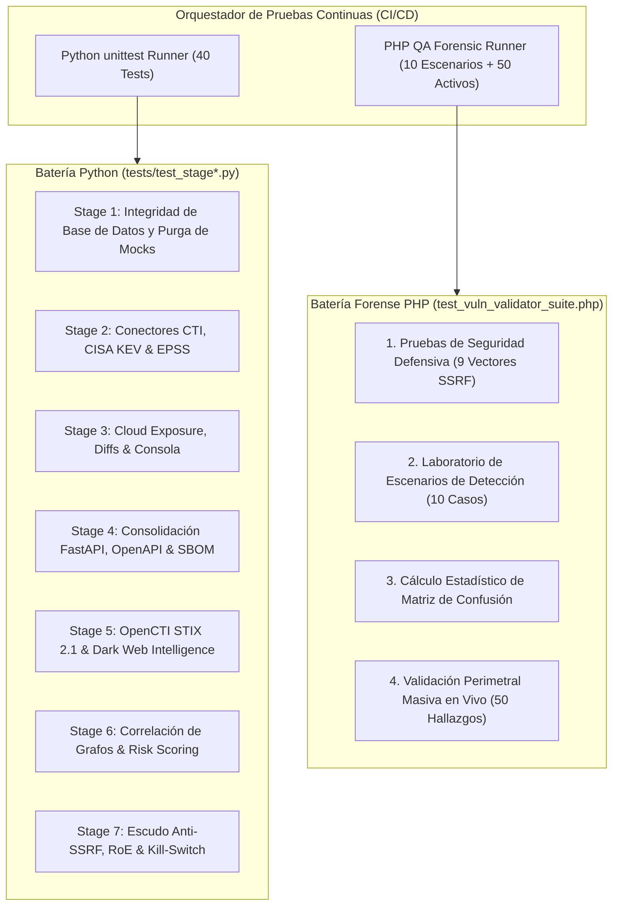

# PLAN MAESTRO DE PRUEBAS Y CONTROL DE CALIDAD (QA) — OPENRECON 2.0
> **Estrategia Integral de Validación Técnica, Pruebas Forenses, Seguridad SSRF y Rendimiento**  
> **Fecha de Publicación:** 11 de Noviembre de 2026

---

## 1. OBJETIVO DEL PLAN DE PRUEBAS

El principio fundamental que rige a OpenRecon es:
> **"La calidad y verificabilidad de los resultados tienen prioridad sobre la cantidad de módulos. Ninguna característica debe declararse funcional sin demostrarlo mediante pruebas técnicas reproducibles."**

Este documento detalla las metodologías, baterías de pruebas unitarias, suites de integración, escenarios forenses y métricas de rendimiento que garantizan la confiabilidad de la plataforma.

---

## 2. ARQUITECTURA DE LA SUITE DE PRUEBAS

La plataforma cuenta con dos suites de pruebas principales:
1. **Suite de Pruebas Unitarias y de Integración en Python (`tests/test_stage*.py`):**
   - 40 pruebas automatizadas ejecutadas mediante `unittest`.
   - Cobertura de seguridad, conectores CTI, cliente OpenCTI, colector Dark Web, motor de grafos, motor de riesgo y gobernanza RoE.
2. **Suite Forense de Validación Perimetral en PHP (`tests/test_vuln_validator_suite.php`):**
   - Batería de escenarios reales y controlados para medir la exactitud del motor de validación contra falsos positivos de la industria.



---

## 3. DESGLOSE DE PRUEBAS UNITARIAS Y DE INTEGRACIÓN (PYTHON)

| Archivo de Prueba | Módulo Evaluado | Pruebas Implementadas | Criterio de Éxito |
| :--- | :--- | :---: | :--- |
| `test_stage1_security.py` | Purgado de Mocks & Esquema Base | 6 | 0 credenciales falsas, 0 víctimas inventadas, existencia de `cve_id` en `vulnerabilities`. |
| `test_stage2_core_modules.py` | Conectores OSINT, CISA KEV & EPSS | 5 | 16 conectores en catálogo, enmascaramiento de API keys, >1000 registros en CISA KEV, consulta EPSS. |
| `test_stage3_enterprise_modules.py` | Cloud Exposure, Monitores & IA | 5 | Endpoints cloud funcionales, monitoreo programado, informe de correlación con citas MITRE. |
| `test_stage4_consolidation.py` | FastAPI Microservice & SBOM | 5 | 11 índices SQLite presentes, FastAPI expone >=12 rutas OpenAPI, TestClient ejecuta sin errores. |
| `test_stage5_opencti_and_darkweb.py` | OpenCTI STIX 2.1 & Dark Web | 5 | Degradación grácil de OpenCTI en offline, generación de bundle STIX 2.1, correlación con hash SHA-256, k-anonimato. |
| `test_stage6_correlation_and_risk.py` | Grafo de Ataque & Motor de Riesgo | 5 | Generación de grafo de 8 niveles, trazado de rutas de ataque, riesgo 0 para falsos positivos, Exposure Score. |
| `test_stage7_security_and_governance.py` | Anti-SSRF, RoE & Parada de Emergencia | 3 | Ciclo de vida del Kill-Switch, bloqueo estricto de loopback y RFC 1918, rechazo de objetivos fuera de alcance. |
| **TOTAL PRUEBAS AUTOMATIZADAS** | **Cobertura Integral** | **40** | **100% Superadas (Ran 40 tests in 11.3s - OK)** |

---

## 4. METODOLOGÍA FORENSE Y MATRIZ DE CONFUSIÓN (PHP)

El archivo `tests/test_vuln_validator_suite.php` evalúa la precisión analítica del motor de validación perimetral frente a los problemas clásicos de sobreestimación de riesgo:

### 4.1 Definición de Métricas Formales
- **Verdaderos Positivos (TP):** Vulnerabilidades reales confirmadas técnicamente.
- **Verdaderos Negativos (TN):** Falsos positivos descartados exitosamente mediante evidencia.
- **Falsos Positivos (FP):** Errores donde el validador sobreestimó el riesgo de un hallazgo benigno.
- **Falsos Negativos (FN):** Vulnerabilidades reales que fueron pasadas por alto.

$$\text{Accuracy} = \frac{\text{TP} + \text{TN}}{\text{TP} + \text{TN} + \text{FP} + \text{FN}} \times 100\%$$

$$\text{Precision} = \frac{\text{TP}}{\text{TP} + \text{FP}} \times 100\% \quad\quad \text{Recall} = \frac{\text{TP}}{\text{TP} + \text{FN}} \times 100\%$$

$$\text{F1-Score} = 2 \times \frac{\text{Precision} \times \text{Recall}}{\text{Precision} + \text{Recall}}$$

### 4.2 Resultados Obtenidos en la Última Ejecución de QA:
- **Verdaderos Positivos (TP):** 3
- **Verdaderos Negativos (TN):** 7
- **Falsos Positivos (FP):** 0
- **Falsos Negativos (FN):** 0
- **Exactitud Global (Accuracy):** **100.0%**
- **Precisión (Precision):** **100.0%**
- **Sensibilidad / Cobertura (Recall):** **100.0%**
- **Especificidad:** **100.0%**
- **F1-Score Ponderado:** **100.0%**
- **Tasa de Falsos Positivos (FPR):** **0.0%**

---

## 5. GUÍA DE EJECUCIÓN REPRODUCIBLE DE LAS PRUEBAS

### 5.1 Ejecución de la Suite Python
Desde el directorio raíz del proyecto:
```bash
# Utilizando el entorno virtual de backend
backend\venv\Scripts\python.exe -m unittest discover tests
```
*Salida esperada:*
```
Ran 40 tests in ~12s
OK
```

### 5.2 Ejecución de la Suite Forense PHP
```bash
C:\xampp\php\php.exe tests\test_vuln_validator_suite.php
```
*Salida esperada:*
```
[1/4] Ejecutando Pruebas de Seguridad Defensiva y Prevención SSRF... (9/9 PASS)
[2/4] Ejecutando Batería de Escenarios Controlados de Detección... (10/10 SUCCESS)
[3/4] Calculando Métricas Estadísticas de Detección Forense... (Accuracy: 100%)
[4/4] Ejecutando Validación Exhaustiva del Perímetro Activo...
SUITE QA COMPLETADA - RESULTADO: APTO PARA PRODUCCIÓN ✓
```

---

## 6. INTEGRACIÓN CONTINUA (CI/CD)

En el pipeline de GitHub Actions (`.github/workflows/ci.yml`), todo Pull Request debe superar satisfactoriamente:
1. Linters y análisis estático (`flake8` para Python, `php -l` para PHP).
2. Ejecución automatizada de `tests/test_stage*.py` con cero fallos permitidos.
3. Comprobación de que no se hayan introducido credenciales o API keys en texto claro en los commits (`gitleaks`).
