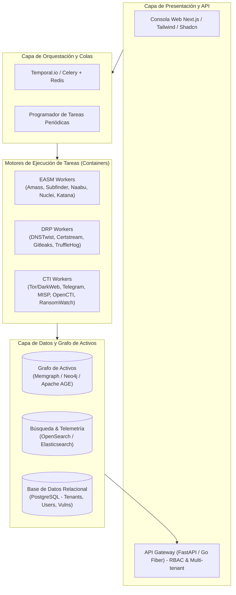
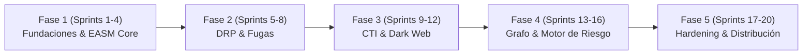

# Plan Maestro: Plataforma Open Source de Ciberseguridad Defensiva y Exposición (OpenRecon)
> **Alternativa Comunitaria y Abierta a FortiRecon, Recorded Future, Cortex Xpanse y CrowdStrike FEM**

---

## 1. Visión del Proyecto y Matriz de Equivalencia

El objetivo es democratizar la ciberseguridad ofensivo-defensiva de alto nivel, permitiendo que cualquier organización (PyME, corporación o ente gubernamental) despliegue una plataforma unificada para descubrir su superficie de ataque externa (**EASM**), proteger su identidad y marca digital (**DRP**), y consumir inteligencia de amenazas táctica y estratégica (**CTI**), utilizando exclusivamente tecnologías libres y arquitecturas desacopladas.

### 1.1 Matriz de Equivalencia con el Mercado

| Producto Comercial (de tu lista) | Especialidad / Fortaleza Clave | Componente / Proyecto Open Source Equivalente |
| :--- | :--- | :--- |
| **Fortinet (FortiRecon)** | Tríada EASM + DRP + Adversary Intelligence | **Core Orchestrator** unificando descubrimiento, monitoreo de fugas y feeds CTI |
| **Recorded Future** (Intelligence Platform) | Inteligencia de amenazas, Dark Web y actores | **OpenCTI + MISP + SpiderFoot + RansomwareWatch** |
| **CrowdStrike** (Falcon Exposure Mgmt) | Gestión de vulnerabilidades y priorización | **Nuclei + DefectDojo + EPSS / KEV Integration** |
| **Palo Alto** (Cortex Xpanse) | Descubrimiento global de activos e infraestructura | **Amass + Subfinder + Naabu + Masscan + Katana** |
| **Microsoft** (Defender EASM) | Gestión continua de superficie de ataque (Cloud/On-prem) | **Cloudlist + S3Scanner + Cloud_enum + DNSX** |
| **Rapid7** (Exposure Command) | Priorización y visibilidad del riesgo externo | **Risk Scoring Engine (CVSS v3/v4 + EPSS + Explotabilidad)** |
| **SOCRadar** | Dark Web, EASM y protección digital integrada | **Tor Scraper workers + Certstream + Telethon (Telegram)** |
| **Cyble** (Cyble Vision) | Inteligencia de amenazas y riesgos de terceros | **HaveIBeenPwned API/Feeds + Secret Scanners (Gitleaks)** |
| **Group-IB** (Digital Risk Protection) | Detección de fraude, phishing y falsificación | **DNSTwist + URLhaus + PhishObserver + Chromium Headless** |
| **ZeroFox** (External Cybersec) | Suplantación en redes, apps móviles falsas y paste sites | **Social Media Scrapers + OSINT paste monitors + App Store crawlers** |
| **CyCognito** | Descubrimiento profundo y validación de exposición | **Wafw00f + Nmap NSE + Nuclei DAST validation engine** |

---

## 2. Arquitectura de Referencia (Open-Recon Engine)

---

## 3. Desglose Funcional por Módulos

### Módulo 1: EASM (External Attack Surface Management)
* **Descubrimiento de Semillas (Seeds):** Dominio principal, ASN, rangos CIDR, nombres de organización y marcas.
* **Enumeración Pasiva y Activa de Subdominios:** Subfinder, Amass, crt.sh, Findomain, DNSX.
* **Mapeo de Redes y Puertos:** Naabu y Masscan optimizados con control estricto de tasa de paquetes (rate-limiting).
* **Fingerprinting y Reconocimiento Web:** HTTPX, Wappalyzer (CLI/API), WhatWeb, Katana (crawler).
* **Descubrimiento de Activos Cloud:** Cloudlist (ProjectDiscovery), Cloud_enum para detectar buckets S3, Azure Blobs y GCP Buckets expuestos o con permisos de lectura pública.
* **Inspección de Vulnerabilidades Ligeras:** Nuclei con plantillas de exposición de paneles, credenciales por defecto, endpoints sensibles (`.env`, `.git`, APIs abiertas).

### Módulo 2: DRP (Digital Risk Protection)
* **Monitoreo de Typosquatting y Phishing:** `dnstwist` periódico + escucha en tiempo real de nuevos certificados TLS emitidos a través de `Certstream`.
* **Fuga de Credenciales y Datos:** Conexión con bases de datos de brechas públicas, paste-sites (Pastebin, JustPaste, etc.), foros públicos y repositorios de código.
* **Secretos Expuestos en Código Abierto:** `gitleaks` y `trufflehog` rastreando commits y repositorios de la organización o desarrolladores clave.
* **Captura de Pantalla y Evidencia:** Workers headless (Playwright/Puppeteer) que capturan evidencia visual de dominios sospechosos para facilitar solicitudes de Takedown (abuso).

### Módulo 3: CTI & Dark Web (Cyber Threat Intelligence)
* **Plataforma Central:** Integración nativa con **OpenCTI** para gestionar amenazas bajo estándar STIX 2.1 y TAXII.
* **Ransomware & Leak Sites:** Agentes programados con proxies Tor (`torsocks` / proxy socks5) que escanean blogs de grupos de ransomware conocidos (`ransomwatch`).
* **Canales de Telegram y Foros Clandestinos:** Workers basados en `Telethon` (API de Telegram) para monitoreo de palabras clave críticas (nombres de dominio de la empresa, BINs bancarios, ejecutivos).
* **Feeds de Reputación:** Ingesta de feeds reputacionales de código abierto (AlienVault OTX, URLhaus, AbuseIPDB, ThreatFox).

### Módulo 4: Scoring y Priorización del Riesgo
* Cálculo de criticidad no solo por severidad CVSS, sino combinando:
  * **EPSS** (Exploit Prediction Scoring System): probabilidad real de explotación.
  * **CISA KEV** (Known Exploited Vulnerabilities): si la vulnerabilidad ya está siendo activamente explotada en el mundo real.
  * **Nivel de Exposición:** ¿Está expuesta a todo Internet o requiere VPN/autenticación?
  * **Valor del Activo:** Definido por etiquetas (ej. producción vs staging).

---

## 4. Cronograma y Plan de Trabajo (5 Fases)

### Fase 1: Arquitectura Base y Motor EASM (Mes 1 - 2)
* **Objetivos:** Tener el pipeline de descubrimiento de activos totalmente operativo.
* **Entregables:**
  1. Definición del modelo relacional en PostgreSQL (Tenants, Orgs, Domains, IPs, Services, Ports).
  2. Implementación de orquestador (Temporal.io o Celery) y workers Dockerizados para:
     * `subfinder` + `amass` + `dnsx`
     * `naabu` + `httpx`
     * `nuclei` (con perfil seguro de verificación)
  3. API REST / GraphQL para disparar escaneos y consultar inventario de activos.
  4. Primer dashboard MVP en Next.js con tabla de activos y estados de puertos.

### Fase 2: Protección Digital (DRP) y Fugas de Secretos (Mes 3 - 4)
* **Objetivos:** Ampliar hacia la protección de marca e identidad corporativa.
* **Entregables:**
  1. Microservicio consumidor de `Certstream` con detección de dominios similares mediante Levenshtein / Phishing heuristics.
  2. Integración de `dnstwist` para generar y verificar registros MX/A de dominios parecidos.
  3. Worker de escaneo de secretos en GitHub/GitLab público (`gitleaks`).
  4. Sistema de generación de reportes y fichas de evidencia para Abuse/Takedown (PDF/HTML con pantallazos de Playwright).

### Fase 3: CTI, Dark Web y Fugas de Credenciales (Mes 5 - 6)
* **Objetivos:** Dotar a la plataforma de inteligencia sobre adversarios y monitoreo de ransomware.
* **Entregables:**
  1. Despliegue de instancia conectora con **OpenCTI**.
  2. Scraper de Ransomware Sites (a través de red Tor) y canales de Telegram de divulgación de fugas.
  3. Módulo de ingesta de hashes de contraseñas filtradas (HaveIBeenPwned API o corpus local anonimizado con k-Anonymity).
  4. Notificaciones en tiempo real vía Webhooks (Slack, Discord, Microsoft Teams, Email).

### Fase 4: Grafo de Ataque, Correlación y Priorización de Riesgo (Mes 7 - 8)
* **Objetivos:** Convertir datos planos en relaciones inteligentes para respuesta ágil.
* **Entregables:**
  1. Implementación de base de datos de grafos (Memgraph / Neo4j) que mapee:
     `[Empresa] -> [ASN/CIDR] -> [IP] -> [Dominio/Subdominio] -> [Servicio/Software] -> [CVE/Exposición]`.
  2. Algoritmo de Risk Score dinámico (Factores: Exposición externa + CVSS + EPSS + KEV).
  3. Integración con **DefectDojo** para gestión formal del ciclo de vida de vulnerabilidades y tickets.

### Fase 5: Plataforma Empresarial, Comunidad y Distribución (Mes 9 - 10)
* **Objetivos:** Facilitar la adopción en cualquier empresa sin fricción técnica.
* **Entregables:**
  1. Despliegue en 1-click mediante `docker-compose.yml` para PyMEs y Helm Charts para clusters Kubernetes.
  2. Módulo de autenticación Single Sign-On (SSO) vía OAuth2 / OIDC / SAML (Keycloak).
  3. Documentación completa: Guías de despliegue, políticas de escaneo ético y rate-limiting.
  4. Publicación en GitHub con licencia permisiva (ej. AGPLv3 o Apache 2.0).

---

## 5. Consideraciones Operativas, Éticas y Legales

- **Políticas de Escaneo No Destructivo (Safe-Check Mode):** El módulo de EASM debe incorporar limitadores de peticiones por segundo (`rate-limiting`), exclusión de rangos gubernamentales o médicos por defecto, y plantillas de escaneo exclusivamente pasivas o de validación no disruptiva.
- **Despliegue Híbrido y Soberanía de Datos:** A diferencia de soluciones SaaS cerradas (donde los activos de la empresa residen en nubes de terceros), una plataforma open-source permite que la empresa mantenga sus datos de activos y vulnerabilidades bajo estricta soberanía interna (On-Premise o en su propia VPC).
