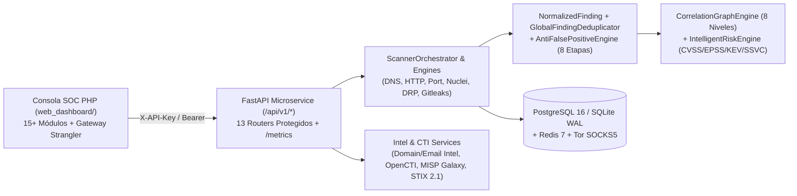

# Plan de Trabajo Maestro — OpenRecon 3.0
> **Plataforma Open Source Integral de EASM, DRP, OSINT y Ciberinteligencia de Amenazas (CTI)**  
> **Versión:** `3.0.0-alpha` → Objetivo `3.0.0 GA`  
> **Última Actualización:** 2026-11-15

---

## 1. Visión y Estado Actual del Proyecto

OpenRecon unifica en una arquitectura modular (**FastAPI + PostgreSQL/SQLite + Redis + Consola SOC PHP**) las tres disciplinas clave de la ciberseguridad defensiva externa (**EASM**, **DRP** y **CTI**), como alternativa abierta y auto-hospedable a plataformas comerciales (FortiRecon, Recorded Future, Cortex Xpanse, CrowdStrike FEM).

### Resumen Ejecutivo de Avance (al 2026-11-15)

| Bloque / Fase | Estado | Resumen de Capacidades Entregadas |
| :--- | :---: | :--- |
| **Fases 0 – 2: Auditoría, Hardening P0 y Arquitectura** | **COMPLETADA** | TLS 1.2+ obligatorio sin bypasses, autenticación global `Depends(require_api_token)` en 13 routers `/api/v1/*`, sanitización de secretos (`SecretRedactingFilter`), escudo Anti-SSRF/DNS-Rebinding, Kill-Switch distribuido (Redis + SQL), migraciones Alembic, `BaseConnector` con Circuit Breaker + Prometheus (`/metrics`). |
| **Fase 3: Domain, Email, GitHub & Web Intel** | **COMPLETADA** | `DomainIntelligenceService` (VirusTotal, OTX, WebOSINT, WhoisXML, HackerTarget, CertSpotter, KEV/EPSS), `EmailIntelOrchestrator` (Zehef OSINT + XposedOrNot v1 + `PasteSearcher` sanitizado), `GitHubIntelConnector` + `gitleaks` sandbox (`POST /api/v1/exposures/secrets/scan`), `WebSecurityAnalyzer`. |
| **Fase 4: CTI, Correlación y Anti-Falsos Positivos** | **COMPLETADA** | Contrato único `NormalizedFinding` + `GlobalFindingDeduplicator` (SHA-256), `AntiFalsePositiveEngine` (8 etapas con guardrail IA), `STIX21TaxiiService`, OpenCTI/MISP, `MISPGalaxyService`, `VulnIntelEnrichmentService` (KEV, EPSS, CISA Vulnrichment SSVC), `CorrelationGraphEngine` (8 niveles) y `IntelligentRiskEngine` con `missing_signals` / `data_completeness`. |
| **Fase 5 & 5.5: Motores Consolidados, QA y Docker Hardened** | **COMPLETADA** | `DNSEngine` (wildcard elimination + `subfinder`/`amass`/`dnsx`), `HTTPEngine` (`httpx` JSONL), `PortEngine` (`naabu`), `NucleiEngine` (v3 `-jsonl` + exclusión destructivos), `DRPEngine` (`dnstwist` + IDN punycode), `backend/Dockerfile` non-root `openrecon` con binarios SHA-256 pinned, suites `test_master_improvement_program.py`, `test_p1_p2_debt_closure.py` y `test_phase5_metrics_benchmark.py`. |
| **Fase 5.6: Integración Selectiva WebCopilot (`WebCopilotAdapter`)** | **COMPLETADA** | Descubrimiento histórico (`gau`/`waybackurls`/`waymore`/`wayback_cdx`), `url_normalizer.py` + GF en Python, `kxss`/`dalfox`/`openredirex_safe`, `NucleiEngine.scan_targets()`, políticas *Safe-by-Default* (`WebOrgPolicy`), API `/api/v1/web-recon/*`, panel en `web_dashboard/index.php` y `test_webcopilot_integration.py` (6/6 OK). |
| **Fase 6: Instalador XAMPP 8.2, Cierre Strangler Pattern y Release 3.0.0 GA** | **EN PROGRESO** | Instalador `install_openrecon.ps1` / `install_openrecon.bat` (XAMPP 8.2 + Python + Alembic + Go tools) completado. Strangler Pattern activo en `web_dashboard/api.php`. Pendiente migrar ola CRUD heredada (`seeds`, `scope`, `assets`, `vulns`, `run_scan`), validar stack completo en Docker Compose y retirar carpetas legacy duplicadas. |

---

## 2. Arquitectura de Referencia Actual

---

## 3. Plan de Trabajo Detallado — Próximos Hitos

### Fase 6: Cierre Strangler Pattern y Release `3.0.0 GA` (Sprints 1–2)

**Objetivo:** Eliminar la doble autoridad entre `web_dashboard/api.php` (`openrecon.sqlite`) y FastAPI (`PostgreSQL 16`), validar el stack completo en contenedores y publicar la versión `3.0.0 GA`.

| ID | Tarea | Prioridad | Dependencias | Entregable / Criterio de Aceptación (DoD) |
| :--- | :--- | :---: | :--- | :--- |
| **F6-01** | **Migrar CRUD `LEGACY_COMPAT` en `web_dashboard/api.php`** (`get_seeds`, `add_seed`, `delete_seed`, `get_scope`, `add_scope`, `delete_scope`, `get_assets`, `get_vulnerabilities`, `update_vuln_status`, `run_scan`) hacia endpoints `/api/v1/organizations/*`, `/api/v1/assets/*`, `/api/v1/scans/*`. | **ALTA** | Token de servicio entre PHP y FastAPI configurado | 100% de mutaciones ejecutadas por FastAPI sobre PostgreSQL/SQLite unificado; tests PHP gateway actualizados sin regresiones. |
| **F6-02** | **Unificación de Autenticación UI ↔ API:** reemplazar compatibilidad híbrida por sesión segura + token rotativo hacia `/api/v1/*`. | **ALTA** | F6-01 | Todas las llamadas desde `web_dashboard/` incluyen `X-OpenRecon-Token` / `Bearer` válido; cero endpoints sin autenticación. |
| **F6-03** | **Validación E2E en vivo con Docker Compose:** levantar `api` + `postgres` (16) + `redis` (7) + `tor-proxy` y ejecutar flujo completo (org → seed → scan → dedup → AFP → STIX 2.1 → Kill-Switch). | **ALTA** | Docker Desktop / Engine operativo | `docker compose up -d --build` saludable (`HEALTHCHECK` OK), migraciones Alembic aplicadas y suite E2E verde contra Postgres + Redis. |
| **F6-04** | **Retiro de código heredado duplicado:** archivar/eliminar `web_dashboard/backend/tools/` y `web_dashboard/engine/` tras confirmar paridad funcional en FastAPI. | **MEDIA** | F6-01, F6-03 | Sin duplicidad de motores entre PHP y Python; documentación `STRANGLER_MIGRATION_MATRIX.md` actualizada al 100%. |
| **F6-05** | **Tag y Release `v3.0.0` GA en GitHub:** actualizar `CHANGELOG.md`, notas de release y SBOM (`docs/SBOM.md`). | **MEDIA** | F6-01 a F6-04 | Todas las suites (`security/`, `integration/`, `e2e/`, PHP) en verde y tag `v3.0.0` publicado. |
| **F6-06** | **Instalador Windows + XAMPP 8.2:** `install_openrecon.ps1` / `install_openrecon.bat` con ApacheFriends XAMPP 8.2, Python venv, Alembic y binarios Go opcionales. | **COMPLETADO** | — | Instalador validado sin privilegios root en runtime, enlace `htdocs\openrecon` y verificación `tests/security` automática. |

---

### Fase 7: Escalabilidad Enterprise, SSO y Despliegue Cloud-Native (Sprints 3–6)

**Objetivo:** Habilitar operación multi-tenant a gran escala (>100,000 activos), autenticación corporativa e integración con ecosistemas SOC/SIEM/SOAR.

| ID | Tarea | Prioridad | Dependencias | Entregable / Criterio de Aceptación (DoD) |
| :--- | :--- | :---: | :--- | :--- |
| **F7-01** | **Cola Distribuida de Workers (Celery / Temporal.io sobre Redis):** desacoplar escaneos largos de los workers HTTP FastAPI con reintentos, prioridad y cancelación vía Kill-Switch. | **ALTA** | F6-03 | Escaneos concurrentes horizontales con cancelación determinista y métricas Prometheus por worker. |
| **F7-02** | **Autenticación Empresarial SSO (OIDC / OAuth2 / SAML 2.0):** integración con Keycloak / Entra ID / Okta y RBAC granular por organización/tenant. | **ALTA** | F6-02 | Login SSO funcional con mapeo de roles (`admin`, `analyst`, `auditor`) y aislamiento estricto de tenants. |
| **F7-03** | **Webhooks y Conectores SOC/SIEM/SOAR:** envío de alertas en tiempo real hacia Slack, Microsoft Teams, Splunk, Microsoft Sentinel, Elastic SIEM y TheHive / Cortex XSOAR. | **MEDIA** | F7-01 | Conectores configurables desde UI con reintentos, Circuit Breaker y firma HMAC en webhooks. |
| **F7-04** | **Helm Charts para Kubernetes:** empaquetado para EKS, GKE, AKS y OpenShift con HPA, NetworkPolicies y secretos externos. | **MEDIA** | F6-03, F7-01 | Despliegue reproducible con `helm install` y documentación operativa en `docs/`. |
| **F7-05** | **Motor de Grafos Externo Opcional:** adaptador para Memgraph / Neo4j / Apache AGE cuando el volumen supere los límites del grafo en memoria/SQL. | **BAJA** | F6-03 | Consultas BFS de rutas de ataque compatibles manteniendo la misma interfaz en `CorrelationGraphEngine`. |

---

## 4. Criterios de Aceptación y Definición de Terminado (DoD)

Todo cambio que ingrese a `main` debe cumplir:
1. **Cero simulaciones o datos mock en producción:** cada conector consulta fuentes reales y degrada de forma segura (`DEGRADED_LOCAL`) ante fallos o ausencia de API Key.
2. **Gobernanza RoE y Anti-SSRF estricta:** validación obligatoria de alcance autorizado, bloqueo de IPs privadas/metadatos cloud y respeto de `Kill-Switch`.
3. **Higiene de Evidencias y Secretos:** sanitización automática antes de persistir o loguear (`EvidenceSanitizer`) y verificación TLS 1.2+ sin bypasses.
4. **Contrato Único y Anti-FP:** todo hallazgo pasa por `NormalizedFinding` + `GlobalFindingDeduplicator` + `AntiFalsePositiveEngine`.
5. **Verificación Automatizada:** ejecución obligatoria de las suites `tests/security/`, `tests/integration/` y `tests/e2e/` sin regresiones antes de hacer merge o tag.
