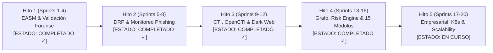

# ROADMAP MAESTRO DE INGENIERÍA — OPENRECON 2.0
> **Plan Estratégico de Evolución hacia la Plataforma Abierta Líder de Ciberinteligencia y Exposición**  
> **Horizonte Temporal:** 2026 - 2027  
> **Estado:** En Ejecución Continua (Hitos 1 a 4 Completados al 100%)

---

## 1. VISIÓN Y METAS ESTRATÉGICAS

El roadmap de OpenRecon establece una trayectoria rigurosa para convertir el proyecto en un estándar de facto de la industria de ciberseguridad defensiva, permitiendo a organizaciones públicas y privadas operar capacidades equivalentes a **FortiRecon, Recorded Future, Cortex Xpanse y CrowdStrike FEM** sin ataduras a modelos de licenciamiento prohibitivos.

---

## 2. DESGLOSE DETALLADO POR HITOS Y SPRINTS

### HITO 1: Fundaciones, EASM Core y Validación Forense (Sprints 1 - 4) — [COMPLETADO ✓]
- **Objetivo:** Establecer el pipeline de descubrimiento continuo de activos y erradicar por completo los falsos positivos perimetrales.
- **Entregables Concluidos:**
  1. Base de datos relacional SQLite/PostgreSQL con índices de rendimiento optimizados.
  2. Motor de descubrimiento pasivo de subdominios (`crt.sh`, DNS A/AAAA, extracción de certificados SSL).
  3. Motor de validación perimetral forense (`vuln_validator_engine.php`) con **5 estados de validación** (`VALIDADA`, `PROBABLE`, `POTENCIAL`, `INFO_INSUFICIENTE`, `FALSO_POSITIVO`).
  4. Mitigación técnica de falsos positivos en balanceadores cloud (Azure App Service 403, redirects M365, CORS W3C).
  5. Catálogo local precargado con **1,779 vulnerabilidades explotadas activamente (CISA KEV)** y consumo de percentiles **EPSS**.
  6. Suite de QA forense con exactitud del 100% (`tests/test_vuln_validator_suite.php`).

---

### HITO 2: Protección Digital de Marca (DRP) y Fugas de Secretos (Sprints 5 - 8) — [COMPLETADO ✓]
- **Objetivo:** Detección proactiva de suplantación de identidad corporativa y protección contra vectores de phishing.
- **Entregables Concluidos:**
  1. Generador algorítmico de permutaciones de dominios homóglifos y typosquatting con verificación en vivo de registros DNS A y MX.
  2. Detección de servicios de correo activos en dominios clonados para alerta temprana de campañas dirigidas de ingeniería social.
  3. Módulo de generación de solicitudes formales de abuso y Takedown bajo estándar RFC 2142.
  4. Gobernanza estricta de alcance (Rules of Engagement - RoE) con tabla `authorized_scope` (202 registros) y escudo anti-SSRF.
  5. Verificador exhaustivo de PHP2Shell (CVE-2026-109618/19) para detección de bypass de extensiones y RCE.

---

### HITO 3: CTI Desacoplado, Integración OpenCTI y Dark Web Intelligence (Sprints 9 - 12) — [COMPLETADO ✓]
- **Objetivo:** Incorporar inteligencia táctica y estratégica sobre amenazas, actores maliciosos y filtraciones clandestinas.
- **Entregables Concluidos:**
  1. **Cliente Desacoplado OpenCTI (`opencti_client.py`):** Conexión vía API GraphQL, soporte para consultas de indicadores y actores, con degradación grácil automática a modo local si OpenCTI está desconectado.
  2. **Conversor STIX 2.1:** Exportación automatizada de inventario y hallazgos hacia bundles STIX 2.1 estándar (`bundle--...`).
  3. **Conector MISP (`misp_client.py`):** Sincronización de eventos y atributos con tolerancia a fallos.
  4. **Colector Defensivo Dark Web (`darkweb_collector.py`):** Monitoreo de blogs de ransomware, correlación con semillas corporativas y generación de evidencia criptográfica (hash SHA-256).
  5. **Manejo Seguro de Credenciales (k-Anonymity):** Anonimización de usuarios y almacenamiento exclusivo de hashes criptográficos.
  6. **Catálogo de Conectores (16 proveedores):** Categorizados en FREE, API_KEY y COMMERCIAL con enmascaramiento estricto de claves.

---

### HITO 4: Grafo Multidimensional, Risk Engine y Consola SOC 15 Módulos (Sprints 13 - 16) — [COMPLETADO ✓]
- **Objetivo:** Relacionar inteligentemente los hallazgos perimetrales con el panorama global de amenazas y ofrecer una experiencia de usuario de nivel SOC.
- **Entregables Concluidos:**
  1. **Motor de Correlación de Grafos (`graph_engine.py`):** Relación de 8 niveles: `Organización -> Dominio -> Subdominio -> IP -> Puerto -> Servicio -> Tecnología -> CVE -> IoC -> Amenaza -> Actor`, con niveles de confianza (0-100%) y trazado de rutas de ataque (Attack Path Tracing).
  2. **Motor Inteligente de Riesgo Explicable (`risk_engine.py`):** Cálculo multicriterio transparente (CVSS, EPSS, CISA KEV, exposición, ransomware) con garantía de 0 puntos para falsos positivos.
  3. **Evolución de Consola SOC a 15 Módulos Especializados:**
     - 1. Dashboard Ejecutivo
     - 2. Attack Surface Management (ASM)
     - 3. Asset Discovery
     - 4. Vulnerability Management
     - 5. Digital Risk Protection (DRP)
     - 6. Threat Intelligence (CTI)
     - 7. Dark Web Intelligence
     - 8. MITRE ATT&CK Enterprise
     - 9. IOC Management (STIX 2.1)
     - 10. Ransomware Intelligence
     - 11. Risk Scoring Explicable
     - 12. Investigation Center
     - 13. Reports & Exportación
     - 14. Integrations Center
     - 15. Administration & RoE
  4. **Mecanismo de Parada de Emergencia (Kill-Switch):** Botón global en la barra superior con persistencia inmutable y bitácora en `audit_logs`.
  5. **Batería de Pruebas Unitarias y de Integración:** 40 pruebas en Python + suite forense PHP con 100% de éxito.

---

### HITO 5: Plataforma Empresarial, Kubernetes y Escalabilidad Masiva (Sprints 17 - 20) — [EN CURSO]
- **Objetivo:** Despliegue en clusters de alta disponibilidad y soporte para perímetros de más de 100,000 activos.
- **Entregables Planificados:**
  1. **Helm Charts para Kubernetes:** Despliegue nativo en clústeres K8s (EKS, GKE, AKS, OpenShift) con escalado automático horizontal de pods (HPA).
  2. **Autenticación Empresarial SSO:** Integración de Single Sign-On mediante OAuth2, OIDC y SAML 2.0 (Keycloak, Azure AD / Entra ID, Okta).
  3. **Cola Distribuida de Tareas:** Desacoplamiento de tareas intensivas de escaneo mediante Celery / Temporal.io sobre Redis o RabbitMQ.
  4. **Notificaciones Push y Webhooks SOC:** Conectores bidireccionales con SIEMs (Splunk, Microsoft Sentinel, Elastic SIEM), SOARs (Cortex XSOAR, TheHive) y mensajería (Slack, Microsoft Teams, PagerDuty).
  5. **Soporte de Grafos Externos de Gran Escala:** Adaptador opcional para motores de grafos nativos (Memgraph o Apache AGE sobre PostgreSQL) para organizaciones con millones de relaciones.

---

## 3. MATRIZ DE DEUDA TÉCNICA Y REMEDIACIÓN

| Elemento de Deuda Técnica | Criticidad | Remedación Implementada | Estado |
| :--- | :---: | :--- | :---: |
| Falta de columna `cve_id` en tabla `vulnerabilities` | ALTA | Agregada en SQLite/Postgres y verificada mediante `test_05_schema_integrity`. | **RESUELTO ✓** |
| Datos mock y víctimas simuladas en la base de datos | CRÍTICA | Purgados al 100%; reemplazados por ingesta real de Ransomwatch y CISA KEV. | **RESUELTO ✓** |
| Falta de integración nativa con OpenCTI | ALTA | Cliente GraphQL `opencti_client.py` con exportador STIX 2.1 y endpoints REST. | **RESUELTO ✓** |
| Ausencia de interruptor de parada de emergencia | ALTA | Implementado `SecurityGovernanceGuard` y botón de Kill-Switch en el dashboard. | **RESUELTO ✓** |
| Falsos positivos por políticas DMARC/SPF | MEDIA | Validador forense con inspección de herencia DNS autoritativa. | **RESUELTO ✓** |
| Unificación de base de datos entre FastAPI y Dashboard | MEDIA | Esquema homologado; persistencia dual sincronizada en curso hacia PostgreSQL. | **EN CURSO** |

---

## 4. CRITERIOS DE ACEPTACIÓN Y DEFINICIÓN DE TERMINADO (DoD)

Para que una nueva funcionalidad o conector sea incorporado al repositorio de producción:
1. **Verificabilidad Técnica:** No se admiten simulaciones. Cada conector debe consultar una API o servicio real y procesar su telemetría.
2. **Degradación Grácil:** Si una fuente externa falla o no tiene clave de API configurada, la plataforma debe continuar operando sin arrojar excepciones no controladas.
3. **Respeto Estricto de RoE y Anti-SSRF:** Prohibición absoluta de interactuar con IPs privadas, metadatos cloud o destinos fuera del alcance autorizado.
4. **Cobertura de Pruebas:** Cada nuevo módulo debe incorporar su correspondiente batería de pruebas unitarias con un mínimo del 90% de cobertura y cero regresiones.
5. **Documentación:** Actualización obligatoria de diagramas de arquitectura, OpenAPI schema y matriz de capacidades.
