# Arquitectura Empresarial — FortiRecon / OpenRecon

Plataforma unificada de **External Attack Surface Management (EASM)**, **Digital Risk Protection (DRP)**, **Cyber Threat Intelligence (CTI)** y **Continuous Threat Exposure Management (CTEM)**.

---

## 1. Diagrama de Arquitectura de la Plataforma

```mermaid
flowchart TD
    subgraph Frontend["Consola Web Unificada"]
        UI["Dashboard Principal (Tailwind CSS, Vis-Network, Chart.js)"]
        TabEASM["Superficie de Ataque (EASM)"]
        TabGraph["Topología de Red (Grafo)"]
        TabVulns["Inteligencia de Vulnerabilidades (5 Estados)"]
        TabDRP["Protección Digital (DRP / Phishing)"]
        TabCTI["Inteligencia de Amenazas (Dark Web & IoCs)"]
        TabCloud["Auditoría de Almacenamiento Cloud"]
        TabConnectors["Centro de Control de Conectores (16)"]
        TabScope["Gobernanza de Alcance RoE & Anti-SSRF"]
        TabAI["Correlación CTI asistida por IA"]
        ModalRisk["Desglose Explicable de Riesgo (0-100)"]
    end

    subgraph APIGateway["Capa de Servicios y Control de Acceso"]
        PHPAPI["API Core PHP Gateway (api.php)"]
        AuthModule["Autenticación & Sesiones (bcrypt, CORS estricto)"]
        ScopeGuard["Validador de Alcance y Escudo Anti-SSRF"]
        RiskEngine["Motor Explicable de Riesgo (CISA KEV, EPSS, NIST)"]
    end

    subgraph BackgroundEngine["Motor Asíncrono de Alto Rendimiento"]
        FastAPI["FastAPI Orchestrator Microservice (Puerto 8000)"]
        DNSEngine["Motor DNS Asíncrono"]
        DRPEngine["Motor DRP de Homóglifos & Typosquatting"]
        HTTPEngine["Sonda HTTP / TLS & Headers"]
        CloudEngine["Auditor de Permutaciones Cloud S3 / Blobs / GCS"]
        PHP2ShellScanner["Verificador PHP2Shell (CVE-2026-109618/19)"]
    end

    subgraph DataStore["Capa de Persistencia e Índices de Rendimiento"]
        SQLiteDB[("openrecon.sqlite (11 Tablas + 11 Índices Optimizados)")]
        TableAssets["assets & open_ports"]
        TableVulns["vulnerabilities (con cve_id, cvss, epss, cisa_kev)"]
        TableScope["authorized_scope"]
        TableConnectors["connectors_config"]
        TableCISAKEV["cisa_kev_catalog (1,779 CVEs activos)"]
        TableCloud["cloud_exposures"]
        TableAudit["audit_logs"]
    end

    subgraph CTIConnectors["Fuentes de Inteligencia Vivas"]
        CISAKEVFeed["CISA KEV (cisa.gov)"]
        EPSSFeed["FIRST.org EPSS API"]
        IPsumFeed["IPsum 30+ Blacklist Aggregator"]
        RansomwatchFeed["Ransomwatch / Ransomware.live"]
        CRTSHFeed["crt.sh Certificate Transparency"]
        HackerTargetFeed["HackerTarget Passive HostSearch"]
        APIKeyFeeds["VirusTotal / Shodan / AbuseIPDB / AlienVault / URLhaus"]
        CommercialFeeds["Recorded Future / CrowdStrike / Mandiant / Censys"]
    end

    UI --> PHPAPI
    PHPAPI --> ScopeGuard
    ScopeGuard --> AuthModule
    PHPAPI --> RiskEngine
    PHPAPI --> SQLiteDB
    FastAPI --> SQLiteDB
    PHPAPI -. Opcional Disparo Async .-> FastAPI

    CTIConnectors --> TableConnectors
    CISAKEVFeed --> TableCISAKEV
    EPSSFeed --> TableVulns
```

---

## 2. Componentes y Módulos de la Solución

### MÓDULO 1: External Attack Surface Management (EASM)
* **Descubrimiento Pasivo Multifuente:** Ingesta registros DNS, logs de transparencia de certificados SSL/TLS (`crt.sh`), y bases de datos pasivas (`HackerTarget`, `RapidDNS`).
* **Verificación Activa de Supervivencia:** Sondeo de DNS A/AAAA y resolución de puertos sin sobrecarga de red.
* **Inventario Tecnológico:** Detección de servidores web (Apache, Nginx, IIS), tecnologías CMS, versiones PHP y encabezados HTTP.

### MÓDULO 2: OSINT & Threat Intelligence Platform (TIP)
* **Separación Estricta de Fuentes:**
  * **Gratuitas:** Sincronización continua de CISA KEV (1,779 vulnerabilidades bajo explotación activa), FIRST.org EPSS, IPsum (más de 30 listas negras de C2 e IPs maliciosas) y telemetría TOR viva de *Ransomware.live*.
  * **Con API Key:** Conectores preparados para VirusTotal, Shodan, AbuseIPDB, AlienVault OTX, URLhaus y ThreatFox con almacenamiento seguro de claves enmascaradas.
  * **Comerciales:** Conectores para Recorded Future, CrowdStrike Falcon, Mandiant y Censys Enterprise.

### MÓDULO 3: Vulnerability Intelligence & Priorización
* **5 Estados de Validación Estrictos:**
  1. `VALIDADA`: Confirmada técnicamente mediante PoC (ej. PHP2Shell) o CISA KEV con puerto perimetral expuesto.
  2. `PROBABLE`: Versión detectada dentro de rango vulnerable de CVE / NVD.
  3. `POTENCIAL`: Tecnología detectada sin confirmación exacta de versión.
  4. `INFO_INSUFICIENTE`: Servicio filtrado o sin datos de respuesta suficientes.
  5. `FALSO_POSITIVO`: Descartada técnicamente por el analista (excluida de penalización de riesgo).
* **Métricas Oficiales:** Mapeo a CVSS v3.1, percentil EPSS y presencia en CISA KEV.

### MÓDULO 4: Digital Risk Protection (DRP)
* **Detección Determinista de Clones:** Generación de typosquats y homóglifos contra el dominio raíz con resolución DNS viva.
* **Riesgo Inminente de Phishing:** Detección de servidores de correo (MX) activos en dominios imitadores.

### MÓDULO 7: Cloud Security Exposure
* **Auditoría de Almacenamiento Cloud:** Detección de buckets AWS S3, contenedores Azure Blob y Google Cloud Storage asociados al nombre del dominio.
* **Diagnóstico Automático:** Clasificación entre `PUBLIC_LISTABLE` (acceso público abierto y listable, alerta crítica inmediata), `ACCESS_RESTRICTED` (403) y `DOES_NOT_EXIST` (404).

### MÓDULO 8 & 9: Monitoreo Continuo & Motor de Riesgo Explicable
* **Algoritmo de Riesgo 0-100:** Cada punto asignado está sustentado por una evidencia comprobable en la base de datos (puertos críticos expuestos, fallas validadas, coincidencia en CISA KEV, suplantación DRP).
* **Auditoría Transparente:** La consola permite consultar el desglose matemático punto por punto.

---

## 3. Seguridad y Controles DevSecOps

1. **Gobernanza de Alcance RoE:** La tabla `authorized_scope` exige que todo objetivo esté registrado antes de realizar sondeos interactivos.
2. **Protección Anti-SSRF:** Bloqueo automático de intentos de escaneo contra rangos privados RFC 1918 (10.0.0.0/8, 172.16.0.0/12, 192.168.0.0/16), bucle local (127.0.0.0/8) y endpoints de metadatos cloud (169.254.169.254).
3. **CORS Estricto:** Eliminación de comodines universales (`*`), restringiendo peticiones a dominios de origen validados.
4. **Almacenamiento de Contraseñas:** Hash seguro con `bcrypt` (`PASSWORD_BCRYPT`).
5. **Auditoría Completa:** Registro persistente en `audit_logs` de toda acción de escaneo, bloqueo SSRF, cambios de configuración y autenticación.
