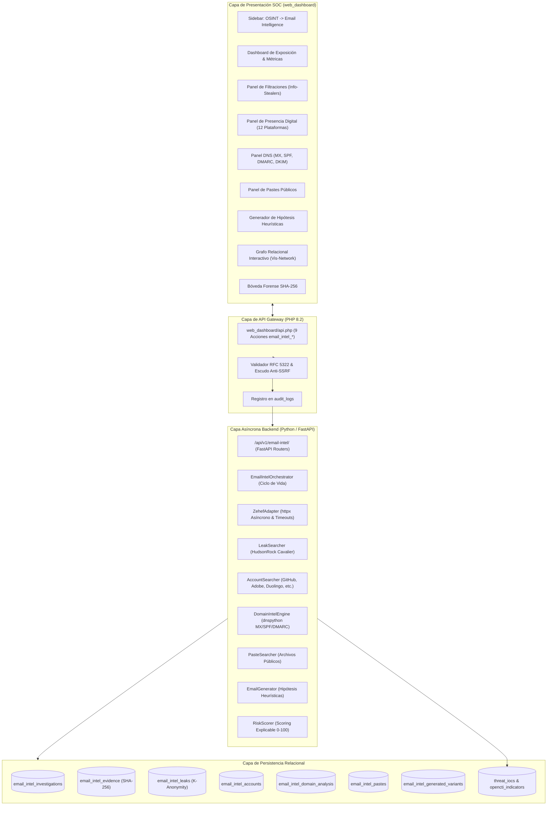

# ARQUITECTURA DE INTEGRACIÓN: EMAIL INTELLIGENCE (ZEHEF ENGINE)
> **OpenRecon Enterprise — Módulo de Inteligencia OSINT de Correos**  
> **Fecha:** 11 de Noviembre de 2026  
> **Versión del Módulo:** 1.0 Enterprise  
> **Base Tecnológica:** Zehef v2.2.1 por N0rz3 (Adaptador Asíncrono Desacoplado)

---

## 1. INTRODUCCIÓN

El módulo **EMAIL INTELLIGENCE** incorpora capacidades analíticas de nivel SOC y DFIR para la investigación perimetral de cuentas de correo electrónico, correlacionando indicadores de exposición en filtraciones, presencia en plataformas digitales, postura de seguridad DNS (SPF/DMARC/DKIM/MX), identificación de variantes heurísticas y registro inmutable en una bóveda forense de evidencias.

A diferencia de herramientas de terminal que imprimen texto sin estructura, Email Intelligence opera como un microservicio completamente acoplado al ecosistema de OpenRecon.

---

## 2. DIAGRAMA GENERAL DE ARQUITECTURA

---

## 3. DESCRIPCIÓN DE COMPONENTES

### 3.1 Adaptador Zehef Desacoplado (`zehef_adapter.py`)
- **Aislamiento de Código:** Encapsula la lógica de Zehef v2.2.1 dentro de un adaptador de red asíncrono con pool de conexiones `httpx.AsyncClient`.
- **Manejo de Tiempos de Espera:** Timeouts estrictos de 5 a 8 segundos por consulta para evitar cuelgues o bloqueos de sockets.
- **Anonimización K-Anonymity:** Métodos estáticos de enmascaramiento (`mask_pii`) que impiden la fuga de nombres y contraseñas.
- **Cadena de Custodia Criptográfica:** Cálculo automático del hash SHA-256 sobre cada cuerpo de respuesta original recibido.

### 3.2 Motor de Filtraciones (`leak_searcher.py`)
- **Fuente Principal:** HudsonRock Cavalier OSINT API (`cavalier.hudsonrock.com`).
- **Política DFIR Innegociable:** **Prohibición absoluta de descargar, almacenar o visualizar contraseñas en texto claro**. La respuesta de la API se sanitiza en memoria: se capturan el recuento de servicios corporativos comprometidos, el número de sesiones de usuario afectadas, el nombre del equipo y el sistema operativo de la víctima, purgando cualquier campo de contraseña.

### 3.3 Motor de Cuentas Digitales (`account_searcher.py`)
Clasificación matemática en 5 estados normalizados:
1. `CONFIRMED`: Prueba inequívoca (perfil localizado en GitHub, avatar Gravatar, confirmación de correo en uso por Adobe, Duolingo, Chess.com, Spotify, Twitter/X, Deezer o BandLab).
2. `PROBABLE`: Coincidencia en directorios comunitarios o búsquedas públicas (Flickr, PicsArt).
3. `NOT_FOUND`: La plataforma confirmó explícitamente que la dirección está disponible o no existe.
4. `INCONCLUSIVE`: Respuesta ambigua, redirección forzada o desafío WAF (ej. HTTP 429 de Instagram, HTTP 403 de Pinterest).
5. `QUERY_ERROR`: Fallo de red, timeout o socket cerrado.

### 3.4 Motor de Postura de Dominio (`domain_intel_engine.py`)
- Consulta autoritativa DNS mediante `dnspython`.
- Detección de proveedor de correo corporativo (Google Workspace, Microsoft 365, Mimecast, Proofpoint, Proton, etc.).
- Análisis de políticas SPF (RFC 7208) evaluando `-all` (estricto), `~all` (softfail permisivo) y `+all` (crítico).
- Análisis de DMARC (RFC 7489) evaluando `p=reject`, `p=quarantine` y `p=none`.
- Sondeo de selectores comunes DKIM.
- Cálculo de puntuación de seguridad (0 a 100) y emisión de recomendaciones de remediación.

### 3.5 Motor de Scoring Explicable (`risk_scorer.py`)
- Calcula el índice de exposición de 0 a 100 y asigna categorías:
  - **CRÍTICO** (85 - 100)
  - **ALTO** (65 - 84)
  - **MEDIO** (40 - 64)
  - **BAJO** (15 - 39)
  - **INFORMATIVO** (0 - 14)
- Justifica de manera transparente cada penalización aplicada al analista.

---

## 4. INTEGRACIÓN CON EL SISTEMA CENTRAL DE OPENRECON

1. **Grafo Relacional Vis-Network:**
   - La función `email_intel_graph` proyecta las entidades del caso en un subgrafo:
     - Nodo Raíz: Dirección de correo (`#0284c7`).
     - Dominio: Dominio corporativo (`#4338ca`).
     - Servidores MX: Servidores de intercambio con prioridades (`#0f766e`).
     - Filtraciones: Incidentes de info-stealer (`#be123c`).
     - Dispositivos: Equipos comprometidos por malware (`#854d0e`).
     - Cuentas: Plataformas digitales confirmadas (`#065f46`).
2. **Correlación Bidireccional de Indicadores (IoCs STIX 2.1):**
   - El botón *Correlacionar como IoC* registra la dirección analizada en `opencti_indicators` y `darkintel_iocs` con tipo `email-addr`, nivel de severidad y enlace a la investigación.
3. **Auditoría Global:**
   - Cada inicio de investigación queda registrado de manera inmutable en `audit_logs` con la IP del operador, usuario y marca temporal UTC.
