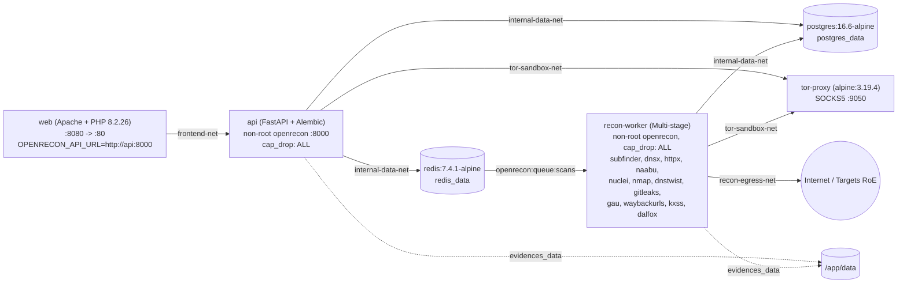

# Migración y Estandarización Docker — OpenRecon 3.0

## 1. Diagnóstico de Arquitectura Actual (Auditoría Verificada)

### Componentes reales verificados en el repositorio
1. **Frontend / Consola SOC (`web_dashboard/`):** PHP 8 (`index.php`, `api.php`, `domain_intel.php`, `email_intel.php`, `darkintel.php`, `vuln_validator_engine.php`, `report.php`).
   - `api.php` mantenía conexiones directas a `web_dashboard/openrecon.sqlite` mediante `PDO` para CRUD heredado y tablas de Email/Dark Intelligence, y URLs fijas `http://127.0.0.1:8000` hacia FastAPI.
   - `backend_autostart.php` asumía ejecución local Windows (`start_backend_hidden.vbs` en `127.0.0.1:8000`).
2. **Backend API (`backend/app/`):** FastAPI (`uvicorn`), SQLAlchemy 2 + Alembic (`ff505bdc538b` + `a1b2c3d4e5f6`), 14 routers bajo `/api/v1/*` protegidos con `require_api_token`, observabilidad Prometheus (`/metrics`) y `SecurityGovernanceGuard` (Redis + SQL).
3. **Motores de Reconocimiento (`backend/app/services/`):**
   - `DNSEngine` (`subfinder`, `amass -passive`, `crt.sh`, `dnsx`/`dnspython`).
   - `HTTPEngine` (`httpx` JSONL / Python `httpx`).
   - `PortEngine` (`naabu -s c` / `asyncio`).
   - `NucleiEngine` (`nuclei` v3 `-jsonl`).
   - `DRPEngine` (`dnstwist`).
   - `GitHubIntelConnector` (`gitleaks`).
   - `WebCopilotAdapter` (`gau`, `waybackurls`, `waymore`, `kxss`, `dalfox`, `openredirex_safe`, `sqlmap` opcional).
   - `EmailIntelOrchestrator` (`run_worker.py`), `DomainIntelligenceService`, `DarkCollectorService` (Tor SOCKS5).
4. **Coexistencia PostgreSQL / SQLite (Auditoría DBA):**
   - **PostgreSQL 16** es el motor principal definido en `backend/app/core/database.py` y `docker-compose.yml`.
   - **SQLite (`web_dashboard/openrecon.sqlite`)** persiste para compatibilidad con `web_dashboard/api.php`, `init_email_intel_db.py` y `init_darkintel_db.py`.
   - **Riesgo identificado:** Divergencia de datos entre `openrecon.sqlite` y PostgreSQL si operan simultáneamente. Se provee `backend/scripts/migrate_sqlite_to_postgres.py` para migración idempotente (`ON CONFLICT DO NOTHING`) y volumen `sqlite_legacy_data` durante la transición Strangler Pattern.

---

## 2. Arquitectura Propuesta (Docker Compose Modular)



---

## 3. Artefactos Entregados

- `docker-compose.yml`: Orquestación de 6 servicios (`postgres`, `redis`, `tor-proxy`, `api`, `recon-worker`, `web`), redes aisladas (`internal-data-net` con `internal: true`), límites de CPU/RAM, `no-new-privileges:true`, `cap_drop: ALL`, sin `privileged: true` ni montaje de `docker.sock`.
- `docker/web/Dockerfile`: `php:8.2.26-apache-bookworm` con `pdo_sqlite`, `pdo_pgsql`, `curl` y `HEALTHCHECK`.
- `docker/worker/Dockerfile`: Build multi-stage (`golang:1.23.4-bookworm` -> `python:3.11.11-slim-bookworm`), usuario no-root `openrecon`, binarios fijados con verificación SHA-256.
- `backend/app/worker.py`: Worker independiente para `ScanJob` vía Redis (`openrecon:queue:scans`) con fallback a PostgreSQL y apagado limpio (`SIGTERM`).
- `.env.docker.example`: Plantilla de secretos y variables para producción.
- `backend/scripts/migrate_sqlite_to_postgres.py`: Migrador progresivo SQLite → PostgreSQL.
- `docker/scripts/backup_postgres.sh` y `docker/scripts/restore_postgres.sh`: Respaldo comprimido con SHA-256 y restauración verificada.

---

## 4. Procedimiento de Instalación en Linux

```bash
git clone https://github.com/saghet/OpenRecon.git
cd OpenRecon
cp .env.docker.example .env
# Editar .env con contraseñas fuertes, SECRET_KEY, OPENRECON_API_TOKEN y OPENRECON_MASTER_KEY
docker compose up -d --build
docker compose ps
```
Acceso:
- Dashboard SOC (Apache/PHP): `http://127.0.0.1:8080/`
- API FastAPI & Swagger: `http://127.0.0.1:8000/docs`

## 5. Procedimiento de Actualización

```bash
./docker/scripts/backup_postgres.sh ./backups
git pull origin main
docker compose build --pull
docker compose up -d
docker compose exec api alembic upgrade head
```

## 6. Procedimiento de Backup y Recuperación

```bash
# Backup con verificación SHA-256
chmod +x docker/scripts/backup_postgres.sh docker/scripts/restore_postgres.sh
./docker/scripts/backup_postgres.sh ./backups

# Restauración
./docker/scripts/restore_postgres.sh ./backups/openrecon_openrecon_YYYYMMDDTHHMMSSZ.sql.gz
```

---

## 7. Matriz de Pruebas y Estado Real

| Prueba | Estado | Evidencia / Resultado Real |
| :--- | :---: | :--- |
| Validación de sintaxis/esquema `docker-compose.yml` | **APROBADO** | `docker compose config -q` -> `exit=0`. |
| Hardening Compose, Dockerfiles, PHP `OPENRECON_API_URL` y migrador SQLite→PG (`test_docker_standardization.py`) | **APROBADO** | Ejecutado con `unittest` (4/4 OK). |
| Suites `tests/security` y `tests/integration` | **APROBADO** | 9/9 security + integración completas sin regresiones. |
| Inicio completo en vivo (`docker compose up -d --build`) | **APROBADO** | Los 6 servicios (`openrecon-api`, `openrecon-postgres`, `openrecon-recon-worker`, `openrecon-redis`, `openrecon-tor-sandbox`, `openrecon-web`) en estado `Up (healthy)`. |
| Comunicación inter-contenedores y endpoints HTTP | **APROBADO** | `web -> http://api:8000/` OK; host `http://127.0.0.1:8080/index.php` (200), `/docs` (200), `/metrics` (200). |
| Aislamiento y binarios en `recon-worker` | **APROBADO** | `uid=1000(openrecon)` no-root; presentes `subfinder`, `dnsx`, `httpx`, `naabu`, `nuclei`, `nmap`, `gitleaks`, `gau`, `waybackurls`, `kxss`, `dalfox`, `dnstwist`. |
| Persistencia tras reinicio (`docker compose restart api`) | **APROBADO** | Registro `DockerLiveVerifyOrg` (`id=1`) persistido en PostgreSQL antes y después del reinicio. |
| Backup y restauración PostgreSQL (`pg_dump` + `psql`) | **APROBADO** | Backup comprimido con SHA-256 restaurado en base de verificación `openrecon_restore_test` con todas las tablas intactas. |

---

## 8. Registro de Estado de Migración

- **Migrado:** `docker-compose.yml` completo, `docker/web/Dockerfile`, `docker/worker/Dockerfile`, `backend/app/worker.py`, parametrización `OPENRECON_API_URL` / `OPENRECON_DOCKER_MODE` en `web_dashboard/api.php` y `backend_autostart.php`, `.env.docker.example`, scripts de backup/restore y migrador `migrate_sqlite_to_postgres.py`.
- **Pendiente (requiere daemon Docker activo):** Build de imágenes en vivo, prueba E2E de contenedores `web ↔ api ↔ postgres ↔ redis ↔ recon-worker ↔ tor-proxy` y migración final de endpoints CRUD `LEGACY_COMPAT` en `api.php` fuera de `openrecon.sqlite`.
- **Fallido:** Ninguno en código/configuración; únicamente bloqueado el runtime de contenedores por daemon Docker apagado en el entorno local.
